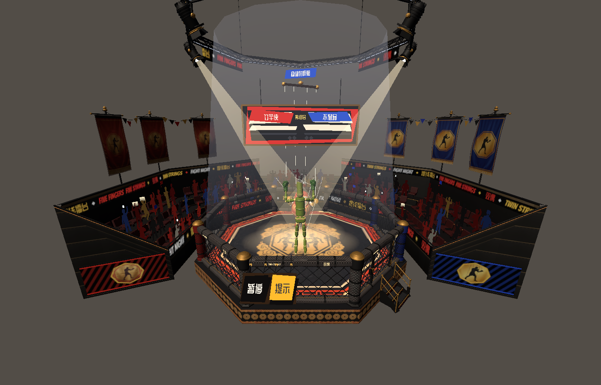
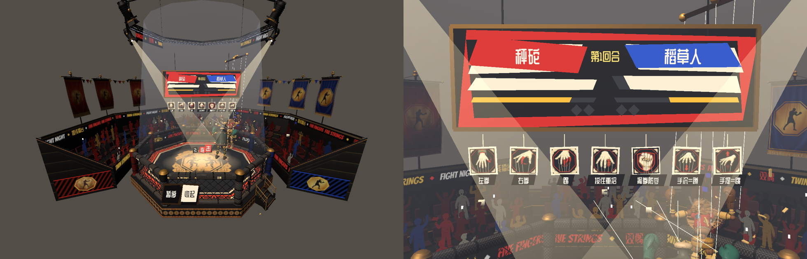
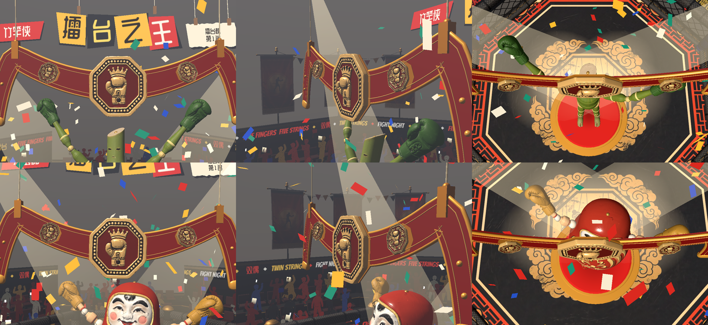

# 双偶 Twin Strings

PICO 头显上的混合现实（MR）提线木偶格斗游戏：一座小擂台摆在你面前的真实桌面上，你的一只手就是提线的十字木架——五根手指各牵一根线，按一下拇指出左拳、勾一下食指出右拳，握拳就是抱头防守。中英双语，带中英文配音。

- 引擎：Unity 6000.5.5f1 + URP，PICO Unity Integration SDK 6.0.0（手势追踪 + 视频透视）
- 包名：`com.toybox.stringbrawl`
- 全程只用一只手（默认右手，设置里可换左手），不用手柄
- 出品：Tripo XR（启动画面 MADE WITH TRIPO；标题页海报下方有出品签）
- 中英双语：英文版标题页的大字是 TWIN STRINGS，中文版是“双偶”
- 安装包：见 [Releases](../../releases)

## 怎么玩

| 动作 | 手势 |
|---|---|
| 走位 | 平移手掌，木偶跟着走 |
| 左拳 / 右拳 | 拇指往下按一下 / 食指勾一下 |
| 踢腿 | 中指、无名指、小指一起收一下 |
| 重招 | 任意一根手指按住不松 = 蓄力，松开打出去（比普通招疼一点，但出手慢） |
| 防守 | 五指握拳 = 双手抱头；挡太多会被打穿，松拳恢复 |
| 下蹲 / 跳 | 手往下一沉 / 往上一提，躲开之后马上出手 = 反击 |
| 必杀 | 怒气满了提线变金色：拇指食指捏住，整只手往下一拽 |

第一次进游戏会在练习场跟木人桩把这九步走一遍。对战时记分屏下面有一块“提示”木牌，点一下展开手势小抄，再点收起。

## 六只木偶

血量都一样，每只只有一项长处，别的都是普通水平或者短处。

| 木偶 | 长处 | 代价 |
|---|---|---|
| 秤砣 | 拳头重 | 出手慢、收招慢 |
| 稻草人 | 怒气涨得快 | 不经打（防守弱） |
| 纸鸢 | 速度快 | 拳头轻、一推就退 |
| 竹竿侠 | 手长脚长 | 贴身打不出力 |
| 铁甲将军 | 防守硬 | 走得慢、出手慢 |
| 不倒翁 | 下盘稳，打不断 | 跳不高 |

## 玩法

- **闯关**：选一只木偶，把另外五只挨个打过去，最后一战是一只跟你一模一样、还学你打法的木偶。
- 每场三局两胜，每打完一小局你的木偶都会说一句。
- **排位（擂台榜）**：从榜尾一路打上去，每位操偶师脾气不同（莽的、慢的、爱防守的、记仇的……）。越往上越会读你的招、会躲，榜首非常难。打到榜首拿金腰带。
- **观战**：大厅里可以看别的操偶师之间的精彩对局，中途能换边看。
- **练习**：回练习场随便打木人桩。
- **设置**：重新摆桌面、摆正、远近三档、操纵手、语言、重置榜单。

## 安装

1. 头显打开开发者模式，用 USB 连接电脑。
2. `adb install -r -g TwinStrings_<版本>.apk`
3. 首次打开时允许“手势追踪”权限。

## 工程结构

| 路径 | 内容 |
|---|---|
| `Assets/_Brawl/Scripts/Runtime` | 全部玩法代码（命名空间 `StringBrawl`） |
| 　`SBMatch` | 对局流程：标题、选人、闯关、排位、观战、设置、结算 |
| 　`SBPuppet` / `SBKit` / `SBDoll` | 木偶本体：出招、受击、防守姿势、六只木偶的数值（平衡表）与外形 |
| 　`SBRival` / `SBPilot` | 电脑对手：读招、闪身、各位操偶师的性格，擂台榜 |
| 　`SBHands` / `SBGestures` | 手部输入与手势识别 |
| 　`SBStage` / `SBUI` | 看板、木牌、文字排版（所有界面都是擂台上的实物） |
| 　`SBArena` / `SBBelt` / `SBPilotHand` | 擂台布景、金腰带、观战时的木制操偶手 |
| 　`SBLines` / `SBFx` / `SBMusic` | 台词与配音、特效、音乐 |
| `Assets/_Brawl/Scripts/Editor` | 搭场景、打包、资源导入设置 |
| `Assets/_Brawl/Resources` | 木偶部件模型（Parts）、界面贴图（UI）、配音（Voice）、字体（Fonts） |
| `Tools/` | 部件建模流水线、配音生成与挑选的 Python 脚本，台词清单 `voice_lines.json`；`Tools/voice/out/pinned` 是定稿的配音原声 |
| `Assets/_Brawl/Brand` | 启动画面用的 MADE WITH TRIPO 图（普通启动画面一张、头显专用一张），打包时由 `SBBuild.ApplySplash` 自动设置 |
| `ArtSource/` | 木偶设定图与概念图、公司标志原件（建模中间文件、参考图体积大，未入库） |

打包：Unity 里切到 Android 平台，执行菜单里的“打包 APK（PICO）”，产物在 `Builds/`。

## 素材来源

- **木偶与金腰带模型**：Tripo 生成后在 Blender 里清理、减面、分级（LOD）。
- **音乐**：全部由代码现场合成（`SBMusic`，弹拨弦算法 + 鼓组），没有外部曲目或采样。
- **配音**：BreezeBlue 语音合成，每只木偶固定一个音色，共 120 句（中英各 60）：选人、每小局赢 / 输、整场赢 / 输、拿金腰带、最终战各有台词。
- **字体**（SIL Open Font License，许可证在 `Assets/_Brawl/Resources/Fonts/`）：站酷庆科黄油体 ZCOOL QingKe HuangYou、Bangers、思源黑体 Noto Sans SC。
